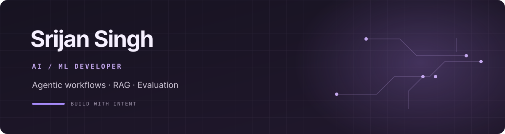

  

  
  
  
  

## About

I’m a final-year Computer Science undergraduate at **SRMIST** in Chennai, building AI workflows that are structured, testable, and useful beyond a demo. My work spans agentic pipelines, RAG, evaluation, and the APIs and interfaces that make AI tools usable.

**9.14/10 CGPA** · **92.1% NLP model test accuracy** · **3 internships**

## Selected work

- **[TRIPMACHA](https://github.com/SrijanSingh2006/tripmacha-ai-travel)** — A phase-sequenced AI travel workflow with tool calling, structured outputs, and automated quality checks.
- **[AgriComply AI](https://github.com/SrijanSingh2006/AgriComply-AI)** — A retrieval-augmented system that grounds answers in domain documents and adds human review gates.
- **[EmotionAI](https://github.com/SrijanSingh2006/Emotion_Predictor)** — An NLP model benchmark with 92.1% test accuracy and deterministic evaluation checks.
- **[ReachInboxAI](https://github.com/SrijanSingh2006/ReachInboxAI)** — A TypeScript workflow engine using BullMQ and Redis for sequenced execution and review.

## Tools I use

  
  
  
  
  
  
  
  
  
  

## How I build

I care about the engineering around AI: clear schemas, repeatable evals, human review when it matters, and documentation that helps someone else run the project.

---

  Chennai, India · <a href="https://srijansingh2006.github.io/PERSONAL-PORFOLIO-WEBSITE/">Portfolio</a> · <a href="mailto:srijansingh2006@gmail.com">Get in touch</a>

